<div align="center">
  
  <p><code>Two sentiment analysis notebooks with reports: BERT vs FinBERT and TF-IDF with Naive Bayes</code></p>

  
  
  
  
  
  
  

  <a href="#-overview">Overview</a> · <a href="#-projects">Projects</a> · <a href="#-preview">Preview</a> · <a href="#-tech-stack">Tech Stack</a> · <a href="#-getting-started">Getting Started</a> · <a href="#-project-structure">Structure</a> · <a href="#-author">Author</a>
</div>


## ◈ Overview

An index of NLP coursework notebooks. Each sub-project is a self-contained Jupyter notebook with its own README and a PDF report.

Two projects are included. One compares a general-purpose transformer with a finance-specific one. The other builds a classical text classification pipeline from scratch. These are academic experiments, not deployed services.


## ◈ Projects

<table>
<tr>
<td width="50%" valign="top">

**Financial Sentiment: BERT vs FinBERT**

Fine-tunes BERT and FinBERT under the same settings to classify financial text as positive, neutral or negative.

- Models: `bert-base-uncased` and `ProsusAI/finbert`
- Data: a PhraseBank-like set and a combined FPB + FiQA set
- Setup: 3 epochs, learning rate 2e-5, batch size 16, max length 128

[Open folder](financial-sentiment-analysis-bert-vs-finbert) · [Notebook](financial-sentiment-analysis-bert-vs-finbert/financial_sentiment_bert_vs_finbert.ipynb) · [Report PDF](financial-sentiment-analysis-bert-vs-finbert/report/financial_sentiment_bert_vs_finbert.pdf)

</td>
<td width="50%" valign="top">

**Twitter Sentiment Analysis**

Classifies tweets as positive or negative with a full preprocessing pipeline, TF-IDF features and Multinomial Naive Bayes.

- Data: Sentiment140, balanced to 200,000 tweets
- Features: TF-IDF, 10,000 features, unigrams and bigrams
- Split: stratified 80/20

[Open folder](twitter-sentiment-analysis) · [Notebook](twitter-sentiment-analysis/twitter_sentiment_analysis.ipynb) · [Report PDF](twitter-sentiment-analysis/report/twitter-sentiment-analysis.pdf)

</td>
</tr>
</table>

### Results recorded in the notebooks

| Project | Model | Dataset | Test accuracy | Test macro-F1 |
|---|---|---|---|---|
| Financial sentiment | BERT-base | PhraseBank-like | 0.837 | 0.822 |
| Financial sentiment | FinBERT | PhraseBank-like | 0.849 | 0.823 |
| Financial sentiment | BERT-base | FPB + FiQA | 0.812 | 0.738 |
| Financial sentiment | FinBERT | FPB + FiQA | 0.824 | 0.783 |
| Twitter sentiment | TF-IDF + Naive Bayes | Sentiment140 (balanced, 40,000 test tweets) | 0.748 | 0.748 |

FinBERT scores higher than BERT on both financial datasets in these runs. The accuracy gap is about one point, so treat it as a small single-run difference rather than a benchmark.


## ◈ Preview

<div align="center">
  
</div>


## ◈ Tech Stack

| Layer | Technologies | Purpose |
|---|---|---|
| Language | Python | Notebook code |
| Transformers | PyTorch, Hugging Face Transformers and Datasets | Fine-tuning BERT and FinBERT |
| Classical ML | scikit-learn, NLTK | TF-IDF, Naive Bayes, stemming and lemmatization |
| Data and plots | pandas, NumPy, Matplotlib | Cleaning, metrics and confusion matrices |
| Environment | Jupyter, Google Colab | Running the notebooks (GPU used for the transformer runs) |


## ◈ Getting Started

Datasets are public. Check the first cells of each notebook for the expected file paths.

```bash
git clone https://github.com/Saji-d/natural-language-processing.git
cd natural-language-processing
pip install jupyter pandas numpy scikit-learn matplotlib nltk torch transformers datasets
jupyter notebook
```

For the transformer notebook a GPU runtime such as Google Colab is recommended. Upload the notebook there and run all cells.


## ◈ Project Structure

Two self-contained sentiment projects, each with a notebook, a README and a report, plus shared banner assets and a preview image.

<details>
<summary>Open the folder map</summary>

```text
natural-language-processing/
├── financial-sentiment-analysis-bert-vs-finbert/
│   ├── financial_sentiment_bert_vs_finbert.ipynb
│   ├── README.md
│   └── report/financial_sentiment_bert_vs_finbert.pdf
├── twitter-sentiment-analysis/
│   ├── twitter_sentiment_analysis.ipynb
│   ├── README.md
│   └── report/twitter-sentiment-analysis.pdf
├── assets/      banner and divider
├── docs/        preview image
└── LICENSE
```

</details>


## ◈ Author

**Sajidur Rahman Sajid**: Full-Stack Developer and AI engineer from Dhaka.<br>
BSc in CSE at American International University-Bangladesh (AIUB).

<p>
  <a href="https://www.sajidur.me"></a>
  <a href="https://www.linkedin.com/in/sajidur-rahman-sajid/"></a>
  <a href="https://github.com/Saji-d"></a>
  <a href="mailto:sajidsajidurrahman99@gmail.com"></a>
</p>

<sub>Released under the MIT licence.</sub>
